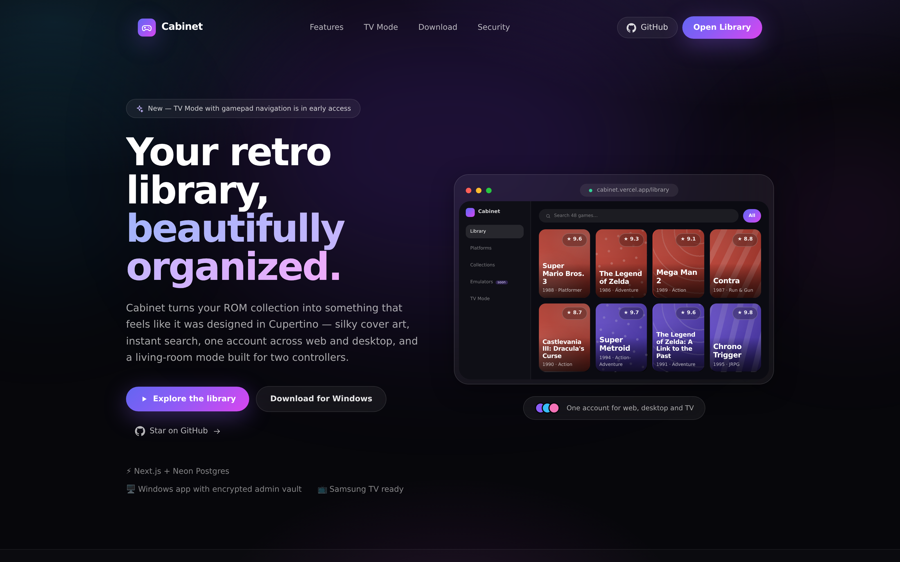
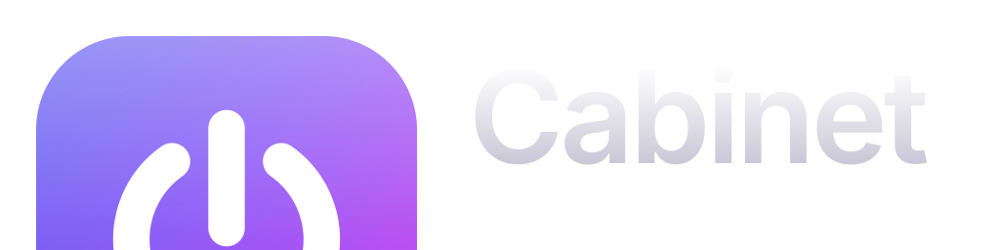
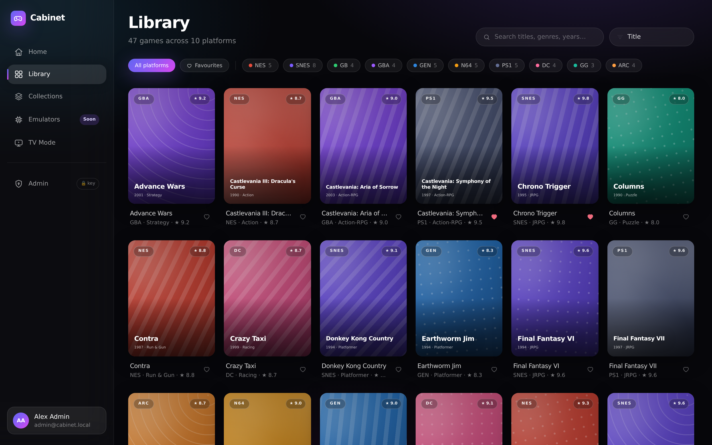
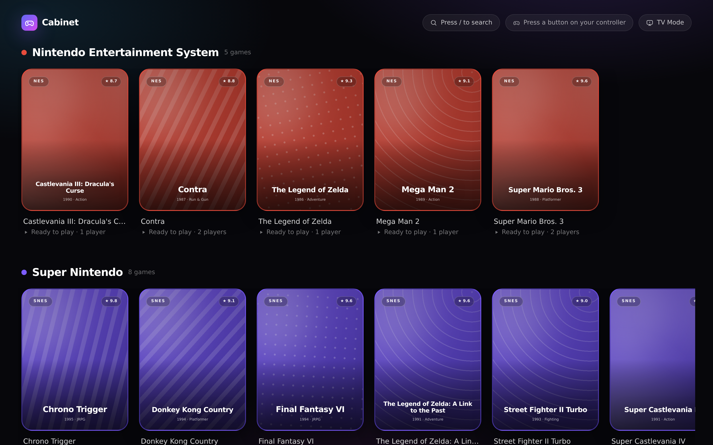
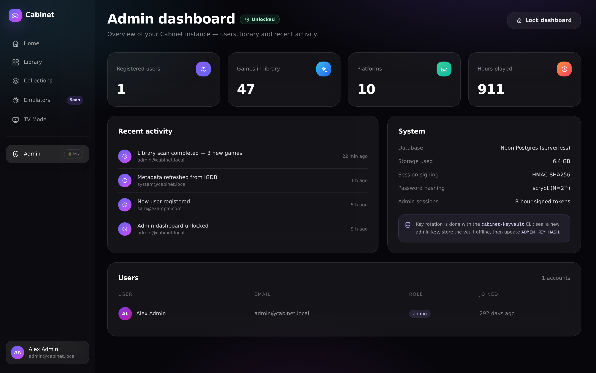
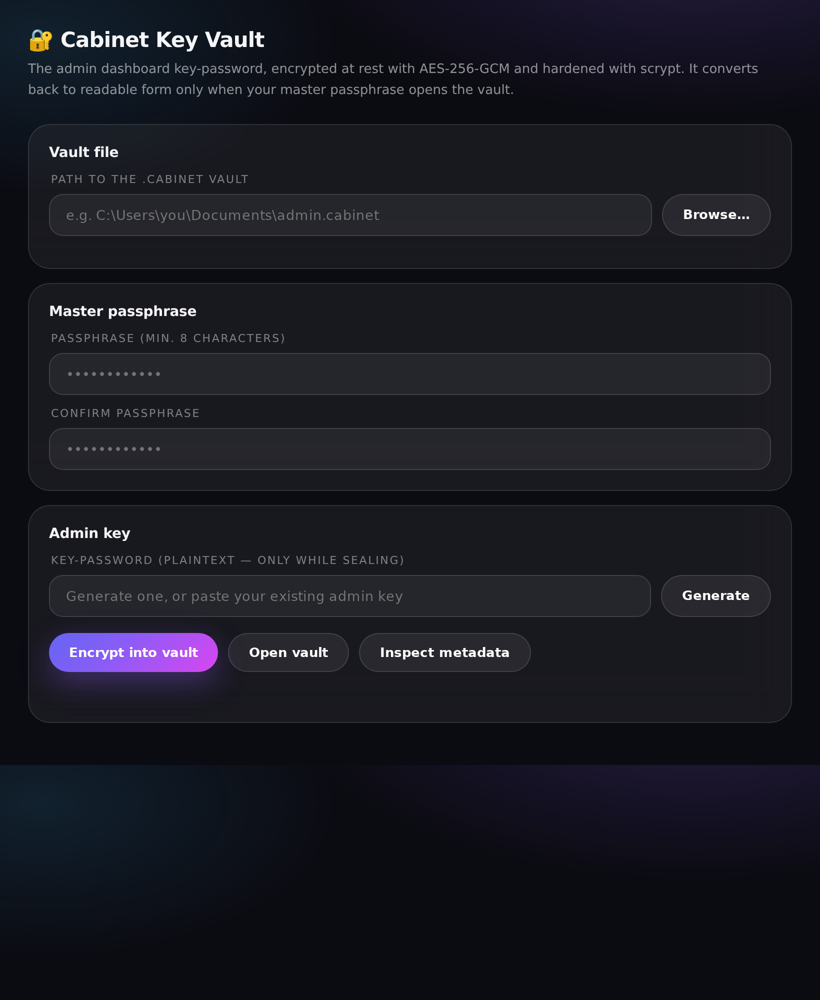

<div align="center">



### Your retro library, beautifully organized.

> The logo hides its idea in the first letter: the **C** of Cabinet is the
> universal power symbol — a circle open at the top, a stem through the gap.
> A letter, and the button that powers on your library.

A modern, self-hostable game library for **web, Windows and TV** — curated cover
art, instant search, an encrypted admin vault, and a controller-first living-room
mode.

[](https://github.com/cabinet-roms/cabinet/actions/workflows/ci.yml)
[](https://vercel.com/new/clone?repository-url=https%3A%2F%2Fgithub.com%2Fcabinet-roms%2Fcabinet)
[](.github/dependabot.yml)
[](docs/ARCHITECTURE.md)
[](https://nextjs.org)
[](https://neon.tech)

[**Explore the demo**](https://cabinet.vercel.app) ·
[**Download for Windows**](https://github.com/cabinet-roms/cabinet/releases/latest) ·
[**TV Mode**](https://cabinet.vercel.app/tv) ·
[**Architecture**](docs/ARCHITECTURE.md) ·
[**TV & controllers**](docs/TV-PLAY.md)

</div>

---

## Why Cabinet?

Romm-style ROM managers solve the problem well — Cabinet is about solving it
with a **modern product feel**: smooth motion, generous curvature, generated
cover art that never breaks, and security that stays out of your way. Same
problem space, different personality. (Today it's a library; as it grows, it
becomes its own thing — consoles were all alike once, too.)

<table>
<tr>
<td width="50%">

**🎨 A library that feels alive**
Generated, palette-aware covers with silky
hover states, fluid layout animations and
filters that update as you type.

**🔍 Instant search & filters**
Platform, genre, year, favourites — one
keyboard shortcut away, everywhere.

**👥 One account, every screen**
Web app, Windows app and TV mode share
one Neon Postgres database and one login.

</td>
<td width="50%">

**📺 Built for the sofa**
TV Mode with big tiles, focus rings and
Gamepad API navigation for **two
controllers** — Samsung TV (Tizen) ready.

**🔐 Admin vault, sealed tight**
Key-protected admin dashboard; on desktop
the key lives in an **AES-256-GCM vault**
that opens only with your master passphrase.

**🧩 Emulators, coming soon**
A dedicated section is already in the
menu — in-browser cores land next.

</td>
</tr>
</table>

## Screenshots

<div align="center">

| Library | TV Mode |
| --- | --- |
|  |  |

| Admin dashboard | Key vault |
| --- | --- |
|  |  |

</div>

## Quick start

### Web app (Vercel + Neon)

```bash
git clone https://github.com/cabinet-roms/cabinet.git
cd cabinet
npm install

cp .env.example .env.local   # add your Neon + session + admin key values
npm run dev                  # http://localhost:3000
```

**Deploy:**

1. Create a [Neon](https://neon.tech) database and copy the **pooled** URL to
   `DATABASE_URL`, the **direct** URL to `DATABASE_URL_UNPOOLED`.
2. Push the schema: `npm run db:generate && npm run db:migrate`.
3. Import the repo at [vercel.com/new](https://vercel.com/new) (root:
   `apps/web`) or click the Deploy button above.
4. Set `SESSION_SECRET` and `ADMIN_KEY_HASH` in Vercel's environment settings.

> **Zero-setup demo:** with no `DATABASE_URL` the app runs against an in-memory
> demo dataset, so `npm run dev` shows the full experience immediately.

### Windows app (.exe)

```bash
npm install
npm run build -w @cabinet/core
cd apps/desktop
CABINET_APP_URL=http://localhost:3000 npm start   # dev
npm run dist                                      # → release/Cabinet-Setup-*.exe
```

See [apps/desktop/README.md](apps/desktop/README.md) for packaging and signing.

## The admin key vault

The admin dashboard is locked behind a key-password on **both** surfaces. On
desktop (and via the CLI) the key can be stored **encrypted** and converted to
readable form only on demand:

```bash
# generate a strong admin key and seal it into an encrypted vault
npm run keyvault -- generate --seal admin.cabinet

# later: open the vault and print the readable key
npm run keyvault -- reveal --in admin.cabinet

# produce the server-side hash (store this as ADMIN_KEY_HASH, not the key)
npm run keyvault -- hash --in admin.key.txt
```

- **Cipher:** AES-256-GCM (authenticated header — tampering fails closed)
- **KDF:** scrypt (N=2¹⁵, r=8, p=1) with a random 16-byte salt
- **Verified by CI:** every build runs `cabinet-keyvault selftest`
  (generate → seal → reveal round-trip, wrong-passphrase rejection)

## Playing on the TV with two controllers

TV Mode (`/tv`) is a controller-first UI: d-pad/stick navigation, **A** to
select, **B** to go back, and live controller detection for up to four pads.
The pragmatic paths to the big screen — ranked by reliability — are in
[docs/TV-PLAY.md](docs/TV-PLAY.md): PC + HDMI (zero fuss), Moonlight Tizen +
Sunshine (wireless), and Tizen packaging of TV Mode (the native-app route).

## Architecture

TypeScript end-to-end: **Next.js 14** on **Vercel**, **Neon Postgres** via
**Drizzle ORM**, **Electron** for the Windows app, and a shared
`@cabinet/core` package (domain types + vault crypto) used by all of them.
The full comparison (including why not Python) lives in
[docs/ARCHITECTURE.md](docs/ARCHITECTURE.md).

```
apps/web        Next.js app — library, collections, TV mode, admin   → Vercel
apps/desktop    Electron shell — ROM scan, emulator launch, key vault → .exe
packages/core   shared types + scrypt/AES-256-GCM key vault (ESM + CJS)
packages/db     Drizzle schema + Neon serverless client
tools/keyvault  CLI: generate / seal / reveal / hash the admin key
```

## Roadmap

- [x] Library with generated cover art, search, filters, favourites
- [x] User accounts (scrypt + revocable opaque sessions)
- [x] Admin dashboard behind a key-password (web + desktop)
- [x] Encrypted admin key vault (desktop window + CLI)
- [x] TV Mode with gamepad navigation (two controllers)
- [x] Dependabot + CI + dependency review
- [ ] Emulators section: in-browser WASM cores (EmulatorJS)
- [ ] Desktop emulator profiles & one-click launch
- [ ] Metadata providers (IGDB, ScreenScraper) & ROM scanning on the server
- [ ] Save states, screenshots and play history sync
- [ ] Tizen web app packaging for Samsung TV
- [ ] Netplay

## Security

See [SECURITY.md](.github/SECURITY.md) for reporting and the full posture:
scrypt password hashing, hashed opaque session tokens, `SameSite`/`HttpOnly`
cookies with origin checks, rate-limited auth endpoints, and an admin
key-password that can live only as an scrypt hash server-side.

Dependabot keeps dependencies current (weekly, grouped minor/patch), and CI
runs a dependency review on every PR.

## Contributing

Issues and PRs are welcome. Please:

1. Fork and create a feature branch.
2. `npm install && npm run typecheck && npm run build` must pass.
3. Keep the design language consistent (rounded, glassy, motion-first) and add
   generated cover art only — no copyrighted images.

## Legal

Cabinet ships **no games, no BIOS files and no emulator cores**. Bring your own
legally obtained dumps; you are responsible for the files in your library.
Cabinet is an independent project, not affiliated with RomM, Nintendo, Sega,
Sony, Samsung or any other company named in the demo dataset.

---

<div align="center">

**Cabinet** — built with TypeScript, Neon and too much care for rounded corners.

</div>
